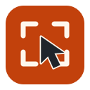

# Кадролов



Локальные снимки и запись экрана с понятным русским интерфейсом. **Сервер, облако и аккаунт не нужны.**

Сочетание клавиш открывает рамку выбора и компактную **панель иконок прямо на экране**. В главном окне два действия — **«Снимок»** и **«Запись»**. Во время записи мини-панель показывает таймер, **«Пауза» / «Продолжить» / «Стоп»**. На Android управление также находится в постоянном уведомлении.

## Возможности

- Снимок экрана или выбранной области, задержка, повтор последней области.
- Редактор: текст и шрифт, стрелки, линии, рамки, круги/овалы, карандаш, маркер, номера, пикселизация, непрозрачное закрытие, обрезка, отмена/повтор. PNG/JPEG/WebP, буфер и локальное сохранение.
- Видео: без звука, системный звук, микрофон либо оба источника. Курсор и круги кликов включаются отдельно, если ОС это позволяет.
- Выбор частоты кадров, разрешения, качества, папки и формата; камера поверх записи.
- Локальная история, изменяемые горячие клавиши и трей на desktop, автозапуск с переключателем; локальный OCR русского/английского текста; обрезка сохранённого видео.
- macOS: ScreenCaptureKit, Vision OCR и нативный MP4 без дополнительных кодировщиков. Windows: GDI/WASAPI; Linux: X11 или Wayland portal/PipeWire/GStreamer. Android: MediaProjection/MediaCodec, настоящий AudioPlaybackCapture.

**Предварительный выпуск [0.1.1](https://github.com/DenKedr/kadrolov/releases/tag/v0.1.1).** Сборка и работа на устройстве — разные проверки. Точные результаты и известные ограничения находятся в [матрице функций](docs/features.csv) и [отчёте проверки](docs/verification.md). Наличие пункта в исходниках не означает испытание на каждой ОС.

## Установка и запуск

Установщики `.exe`, `.deb`, `.dmg` и подписанный `.apk`, а также portable-архивы публикуются в [Releases](https://github.com/DenKedr/kadrolov/releases); текущие CI-сборки — в [Actions](https://github.com/DenKedr/kadrolov/actions).

### macOS 13+

Откройте DMG и перетащите `kadrolov.app` в «Программы», либо распакуйте ZIP. В системных настройках разрешите запись экрана; микрофон/камера нужны только при включении соответствующей функции. Публичный пакет имеет ad-hoc подпись и пока не нотарифицирован Apple. Для локальных повторных сборок можно задать `KADROLOV_SIGN_IDENTITY` в скрипте упаковки: постоянная Apple Development identity сохраняет соответствие системного разрешения между сборками.

MP4 и локальный OCR работают на системных API. Для WebM/MKV и обрезки видео установите [FFmpeg](https://ffmpeg.org/download.html) (например, `brew install ffmpeg`). Круги кликов доступны с macOS 15.

### Windows 10/11

Запустите `kadrolov-windows-ARCH-setup.exe`: установка выполняется для текущего пользователя без администратора. Либо распакуйте portable ZIP целиком и запустите `kadrolov.exe`. Обычный MP4 записывает встроенный `kadrolov-capture.exe`: Media Foundation/GDI/WASAPI, без виртуального аудиодрайвера и FFmpeg. Камера также встроена в нативный модуль. Для WebM/MKV и обрезки установите [FFmpeg](https://ffmpeg.org/download.html), доступный через PATH или лежащий рядом с приложением. Его разрядность должна подходить Windows; текущие популярные сборки FFmpeg для x64 нельзя использовать на 32-bit Windows. `kadrolov-audio.exe` нужен только дополнительному FFmpeg backend.

### Linux

DEB устанавливается командой `sudo apt install ./kadrolov_0.1.1_ARCH.deb`; в меню появится Кадролов. Архитектуры DEB: `amd64`, `arm64`, `i386`, `armhf`. DEB 0.1.1 собираются в чистом Debian12: Qt6 для amd64/arm64, Qt5 для legacy32; зависимости проверяются пакетным менеджером.

Portable-пакет зависит от Qt соответствующей ветки (Qt6 для x64/ARM64, Qt5 для legacy32), image-format plugins и FFmpeg. Для Ubuntu/Debian современные зависимости:

```sh
sudo apt install libqt6widgets6 libqt6printsupport6 libqt6network6 qt6-image-formats-plugins ffmpeg
```

Wayland дополнительно использует системные портал/PipeWire и Python GStreamer bindings — [инструкция](native/linux/README.md). Приложение не меняет сессию и настройки безопасности автоматически. Для OCR на Linux/Windows установите Tesseract с моделями `rus` и `eng`.

### Android 10+

Установите `kadrolov-android.apk` из выпуска — один APK содержит ARM32/ARM64/x86/x64 и подписан постоянным ключом Кадролова. Отдельные debug APK из Actions используются для CI. Каждый захват начинается с системного согласия. Системный звук доступен только от приложений, разрешающих его захват. Плавающая мини-панель запрашивает отдельное разрешение «Поверх других приложений»; без него сохраняется управление в уведомлении и основном экране. Подробности: [Android README](android/README.md).

## Сборка desktop

C++17, CMake ≥3.20, Qt5.15 или Qt6, Ninja/компилятор. macOS также требует Xcode Command Line Tools/Swift и SDK с ScreenCaptureKit.

```sh
cmake -S . -B build -G Ninja -DCMAKE_BUILD_TYPE=Release
cmake --build build -j2
QT_QPA_PLATFORM=offscreen ctest --test-dir build --output-on-failure
```

Публичные macOS-пакеты собираются с Qt 6.8.3 и deployment target 13.0 ([поддерживаемые версии Qt](https://doc.qt.io/qt-6.8/supported-platforms.html)). Новые Homebrew Qt могут требовать более свежую macOS; это нужно учитывать при самостоятельной сборке.

На Mac с Homebrew добавьте `-DCMAKE_PREFIX_PATH="$(brew --prefix qtbase)"`. Нативный helper собирается автоматически. Запуск: `open build/kadrolov.app`; Linux: `build/kadrolov`. В Visual Studio используйте `-A x64`, `-A ARM64` или `-A Win32` и соответствующую Qt.

Android:

```sh
cd android
./gradlew --no-daemon --max-workers=2 :app:testDebugUnitTest :app:lintDebug :app:assembleDebug
```

CI описывает x64/ARM64 Windows/Linux/macOS, x86 Windows/Linux, ARMv7 Linux и Android. Современная macOS не поддерживает 32-bit приложения. ARM32 Windows не заявляется современной целевой платформой.

## Данные и восстановление

История хранит пути к локальным файлам, не копии медиа. Исходные пользовательские изображения не перезаписываются без выбора. При обычном экспорте редактор сохраняет сведённое изображение; скрытые пиксели не отправляются в OCR/буфер. Пикселизация не является гарантией сокрытия секретного текста — используйте непрозрачное закрытие.

Запись сначала идёт в скрытую папку `.kadrolov-...` рядом с выбранным файлом. После успешного завершения готовый файл перемещается на итоговый путь; при ошибке временные части сохраняются для восстановления. Не удаляйте их, пока не проверили результат. Приложение не загружает файлы и не отправляет телеметрию.

## Проект

[Описание](docs/superpowers/specs/2026-10-26-kadrolov-design.md), [UX](docs/ux.md), [план](docs/superpowers/plans/2026-10-26-kadrolov.md), [сторонние компоненты](THIRD_PARTY.md), [сборка установщиков](docs/installers.md). MIT — для собственного кода; Qt, FFmpeg и OCR-компоненты сохраняют свои лицензии.

## Горячие клавиши и автозапуск

В «Настройках» можно изменить отдельные сочетания для снимка и видео. Windows/Linux default: Print Screen и Ctrl+Shift+Print Screen. macOS default: Control+Option+S/V. Если сочетание занято системой/другой программой, назначение не применяется и прежние настройки сохраняются. Wayland может ограничивать глобальные сочетания.

Автозапуск по умолчанию выключен. После включения desktop приложение запускается при входе пользователя, без автоматического захвата. На Android включается только уведомление быстрого доступа после загрузки, если разрешены уведомления; запись всегда требует согласия MediaProjection. Отключение доступно в том же меню.

## Работа в фоне

Крестик скрывает главное окно: программа, горячие клавиши и текущая запись продолжают работать. Открыть окно можно через значок в трее/Dock или повторным запуском ярлыка — второй экземпляр не создаётся. Для полного завершения выберите **«Выход»**; активную запись программа предложит сначала сохранить.

В «Настройках» есть переключатель **«Запускать Кадролов при входе в систему»**. Включённый автозапуск запускает программу скрыто (`--background`), без снимка или записи. По умолчанию выключен. На Android переключатель быстрого доступа после перезагрузки восстанавливает уведомление; активная запись работает независимо от открытого экрана приложения — [подробности](docs/android-background.md).
